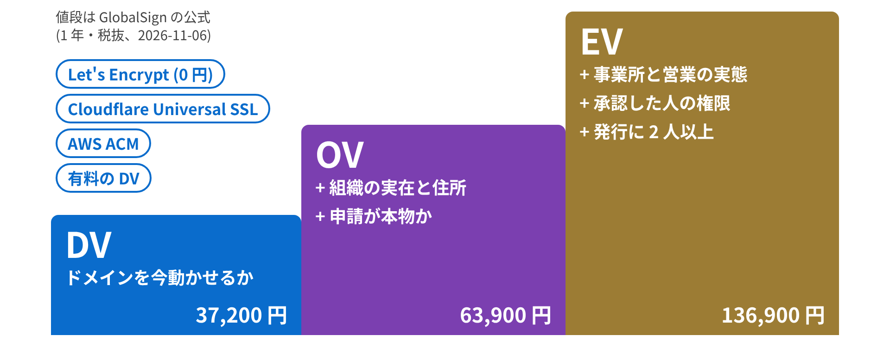
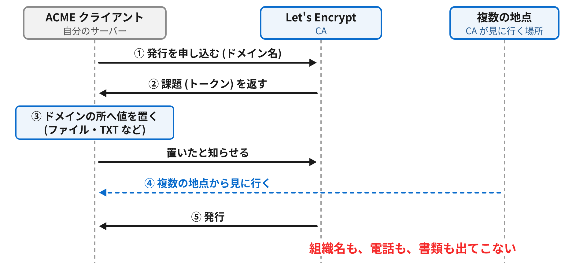
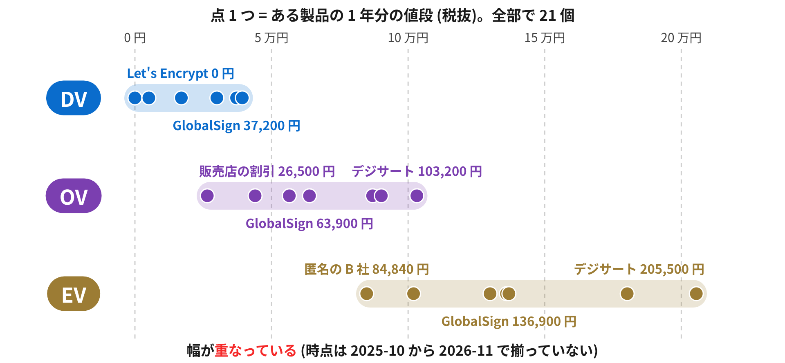
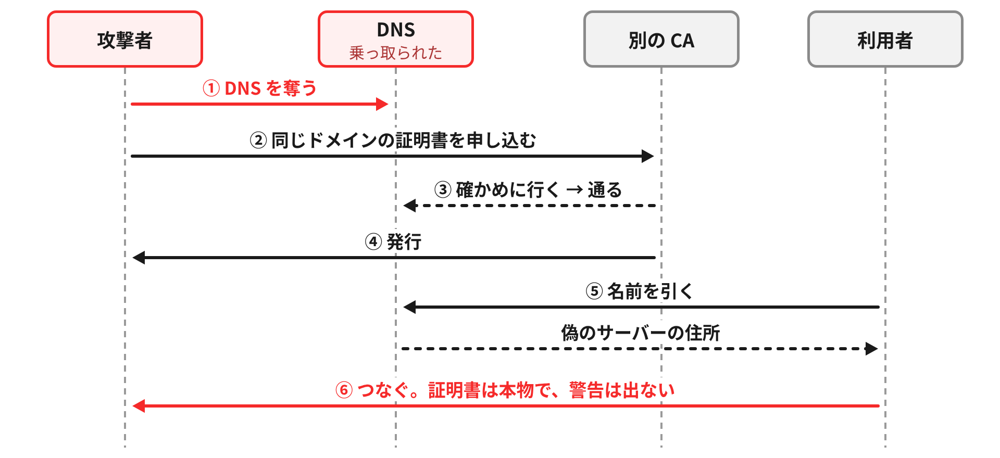
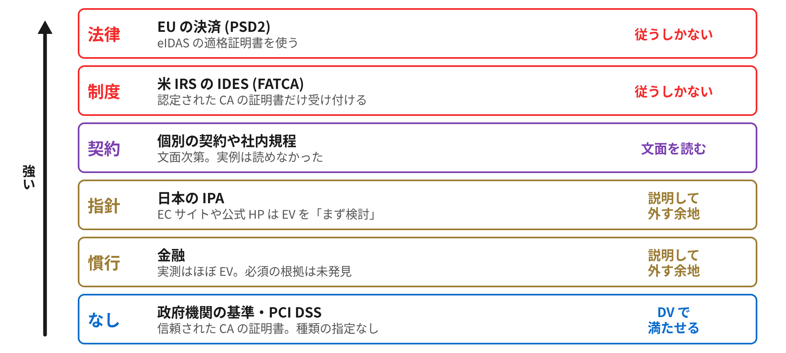

## はじめに

そういえば、会社向けの SSL/TLS 証明書って高かったりする。Let's Encrypt なら 0 円なのに、EV と呼ばれる証明書は GlobalSign の公式の価格で 1 年 136,900 円 (税抜)。なんでこんなに高いのか、高いお金を払うと何が手に入るのか、信頼性が上がるのか、特定の企業だと求められるのか。理解が曖昧なので整理してみることにした。

ついでに、手軽さで有名な Let's Encrypt が確かめていることは、DV・OV・EV のどの段にあたるのかも見ておく。自分用のメモも兼ねてざっくりまとめる。同じ話を、約 33 分の解説動画にもした。

https://www.youtube.com/watch?v=sqzkug5FRmc

:::message
2026-11-06 時点の情報。値段は時期と売り手で変わるので、買うときは各社の最新の価格表を見てほしい。
:::

## TL;DR

- Let's Encrypt が確かめるのは「そのドメインを今動かせるか」だけで、DV・OV・EV の階段のいちばん下の段。無料の DV も有料の DV も同じ段
- 高い理由の土台は、人の審査と付帯サービス。ただ審査の量では説明がつかない開きもある
- 高くても暗号は強くならず、ブラウザの表示の差も 2019 年にほぼ消え、偽の証明書も防げない
- **買えるのは「CA が確かめた組織名が証明書に載ること」と「要件を満たせること」**
- 求められる場面はあるが、まず要件の文面を読むのが早い

## Let's Encrypt はいちばん下の段

証明書の種類は、確かめる範囲が広がる階段みたいなもの。違うのは CA が発行の前に何を確かめたかで、暗号の強さの話ではない。



Let's Encrypt が出しているのは、いちばん下の DV だけ。FAQ によると、OV と EV を出さない主な理由は、発行を自動化できないからとのこと。確かめる流れも ACME で自動になっている。



課題を受け取って、ドメインの所に値を置くと、CA が複数の地点から見に行く。確かめるのは「今動かせるか」で、持ち主が誰かは見ていない。

つまり、無料の Cloudflare Universal SSL や AWS ACM も、数万円する有料の DV も、確かめる範囲は同じ段になる。

どの段かは手元でも見られる。

```sh
openssl s_client -connect <host>:443 -servername <host> </dev/null 2>/dev/null \
  | openssl x509 -noout -subject -issuer -ext certificatePolicies
```

DV の `subject` (証明書の持ち主の欄) はドメイン名だけ。OV は `O` に組織名が載り、EV はさらに設立した州や登記番号まで載る。

## OV と EV で増えるもの

OV は、組織の実在と住所を、政府機関やデータベース、現地の訪問などで確かめる。申請が本物かも、別の情報源で確かめた連絡手段で確かめる。ここで人が関わるようになる。

EV はさらに、実際に事業をしている場所か、営業の実態はあるか、署名や承認をする人に権限はあるかまで見る。最後に別の人が全部を見直し、発行には 2 人以上の操作が要る。

## 値段の中身

値段を並べるとこうなる。時点も売り手も揃っていないので、形だけ見てほしい。



土台は確かにこの人手で、ほかに再発行や返金保証みたいな付帯サービスも入っている。Let's Encrypt の 0 円のほうは、自動化と寄付で成り立っていて、直接のサポートは無いとのこと。

ただ、審査の量だけでは説明がつかない開きもある。

- 同じ DV でも 0 円から 3 万円台まで開く。確かめる範囲は同じ段
- GlobalSign の資料の匿名の比較だと、EV の B 社 (84,840 円) が OV の A 社 (90,200 円) より安い
- 同じ OV の製品が、販売店では 58% 引きで売られている (ITreview の 2026-09-18 の表示)

原価の内訳は公開されていないので、ここからは推測になる。人手の原価だけでなく、ブランドや、要件のために買わざるを得ない買い手の事情で決まっている部分も大きいと思う。

## 高くても買えないもの

まず暗号。46 サイトに接続してみたら、DV の 9 サイトはすべて TLS 1.3、EV の 24 サイトのうち 4 サイトは TLS 1.2 だった。手で選んだサイトで統計ではないが、証明書の種類で暗号は決まらない。

次にブラウザの見た目。以前の EV はアドレスバーが緑になって会社名が出ていたが、2019 年に Chrome 77 と Firefox 70 で消えて、今はアイコンをクリックしないと組織名は見えない。Google のチームが Chrome の利用者の 1% で表示を消した実験 (2019 年) でも、行動の指標はほとんど変わらなかったらしい。

それと、偽の証明書も防げない。



2019 年に Cisco Talos が報告した Sea Turtle がこの形で、DNS を乗っ取り、別の CA から同じドメインの証明書を取っていたとか。CA が見るのは「今動かせるか」だけなので確認は通り、自社が EV を買っていても止まらない。効くのは値段ではなく、DNS の管理と CAA と CT のほう。

CA の事故からも免除されない。2024 年の DigiCert の 83,267 枚の失効、同じ年の Chrome の Entrust の不信任、2026 年の [eMudhra の件](https://zenn.dev/pollenjp/articles/2026-10-22-emudhra-weak-ca-keys) と、どこが良い悪いではなく、買った側にも入れ替えが急に回ってくることがある。

## 買えるものと、求められる場面

はっきり増えるのは、CA が確かめた組織名。証明書を開けば誰でも確かめられて、監査や取引先への説明の材料になる。ただ、同じ名前の別の法人は作れる。2017 年に Ian Carroll さんがケンタッキー州に「Stripe, Inc」を作って EV を取った話があって、かかったのは約 177 ドル。名前だけで本物とは言い切れない。

もう 1 つが要件を満たせること。



どこまで外せるかは自分の読み。

- **法律**: EU の決済 (PSD2) は eIDAS の適格証明書を使う
- **制度**: 米 IRS の IDES は認定された CA の証明書しか受け付けない
- **指針**: 日本の IPA は、EC サイトや企業の公式 HP に EV を「まず検討すべき」と書いている
- **慣行**: 金融。実測では銀行と証券の 14 host のうち 13 が EV だった。ただ、金融庁の監督指針などを検索しても EV の語は無かった (FISC の基準は有料で読んでいない)
- **指定なし**: 政府機関のガイドラインや PCI DSS (PCI DSS は二次資料で確かめた)

調達の仕様書で OV や EV を指定する文面は、探しても読めなかった。「取引先に求められた」と言われたら、まず文面を確かめるのが早いと思う。

ちなみに IPA は、フィッシングサイトの証明書のほぼすべてが DV であることも理由に挙げている。ただ世の中の証明書もほとんどが DV で、2018 年 4 月に調査会社の Netcraft が数えた有効な証明書 約 2,950 万枚の 94.3% が DV。フィッシングの 99.1% は、Phishbank の 30 日分から SSL/TLS を使うサイト 3,218 件を見た数字で、世界中のフィッシングを全部数えたものではない (どちらも CA の Entrust Datacard の資料)。値段の根拠は、監査や取引先への説明へ移っているんじゃないかと思う。ここも推測。

## これからの変化と、自分ならどう決めるか

業界のルール (Baseline Requirements) が決めている日数は 3 つ。有効期間の上限は、証明書 1 枚を使える日数。ドメイン確認の流用は、「ドメインを動かせる」と確かめた結果を次の発行に使い回せる日数。組織の情報の流用は、組織の実在や名前を確かめた結果を使い回せる日数 (OV と EV だけ)。

有効期間の上限は 2026-03-15 に 200 日、2027-03-15 に 100 日、2029-03-15 に 47 日になり、ドメイン確認の流用も 10 日まで縮む。47 日だと更新は年に 8 回以上で、手作業で続けるのは値段によらずきつい。一方で組織の情報の流用は 398 日のままなので、OV と EV の人の審査は年 1 回ほど残る。Let's Encrypt はもっと先で、既定の `classic` も 2028 年に 45 日になるとのこと。

Chrome のルールも、2027-03-15 から、どの種類の証明書も自動で発行と更新ができるよう CA に求める。

自分ならこう決める、というのはこんな感じ。

- 要件の文面に種類や CA の名前があれば従う。「信頼された CA の証明書」とだけなら DV で満たせる
- 指定が無ければ、証明書に組織名を載せて見せる相手がいるかで決める。いるなら OV・EV が候補で、いなければ無料の DV で技術的な不足はない
- EC や企業の公式サイトで DV にするなら、IPA の勧めがあるので理由を残しておく
- どれを選んでも、更新の自動化と、DNS の管理・CAA・CT は別に用意する

## おわりに

最初の疑問に戻ると、高いのは人が確かめる手間に、ブランドや買い手の事情が乗っているから (後ろ半分は推測)。メリットは、確かめた組織名が載ることと、要件を満たせること。信頼性については、ブラウザの扱いは同じで、高くなるのは運営者の身元の確かさ。それも証明書を開いて確かめる人にしか届かない。特定の企業で求められるかは、要件の文面次第だった。

自分のサイトの証明書がどの段にあるか、一度 openssl で見ておくとよいでしょう。

もし誤っているところがありましたらごめんなさい。コメントで教えてもらえると助かります。

## 参考

- [Let's Encrypt の FAQ](https://letsencrypt.org/docs/faq/)・[Decreasing Certificate Lifetimes to 45 Days](https://letsencrypt.org/2025/12/02/from-90-to-45/)
- [CA/Browser Forum Baseline Requirements v2.3.1](https://github.com/cabforum/servercert/blob/main/docs/BR.md)・[EV Guidelines v2.0.4](https://github.com/cabforum/servercert/blob/main/docs/EVG.md)
- [Chrome Root Program Policy v1.8](https://googlechrome.github.io/chromerootprogram/crp/policy)・[EV UI Moving to Page Info (Chromium)](https://chromium.googlesource.com/chromium/src/+/HEAD/docs/security/ev-to-page-info.md)
- [IPA TLS 暗号設定ガイドライン Ver. 3.1.1](https://www.ipa.go.jp/security/crypto/guideline/gmcbt80000005ufv-att/ipa-cryptrec-gl-3001-3.1.1.pdf)
- [The Web's Identity Crisis (USENIX Security 2019)](https://www.usenix.org/conference/usenixsecurity19/presentation/thompson)
- [DNS Hijacking Abuses Trust In Core Internet Service (Cisco Talos)](https://blog.talosintelligence.com/seaturtle/)
- [Delegated Regulation (EU) 2018/389 Article 34 (英国の法令サイトの写し)](https://www.legislation.gov.uk/eur/2018/389/article/34)・[IRS Digital certificates](https://www.irs.gov/businesses/corporations/digital-certificates)
- [GlobalSign の価格一覧](https://jp.globalsign.com/ssl/products_price/)・[SSLサーバ証明書 サービス比較 (GlobalSign、2025-10)](https://jp.globalsign.com/contact/common/pdf/server_security_compare.pdf)
