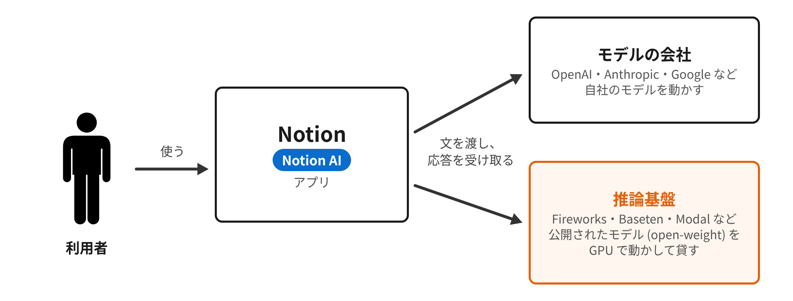
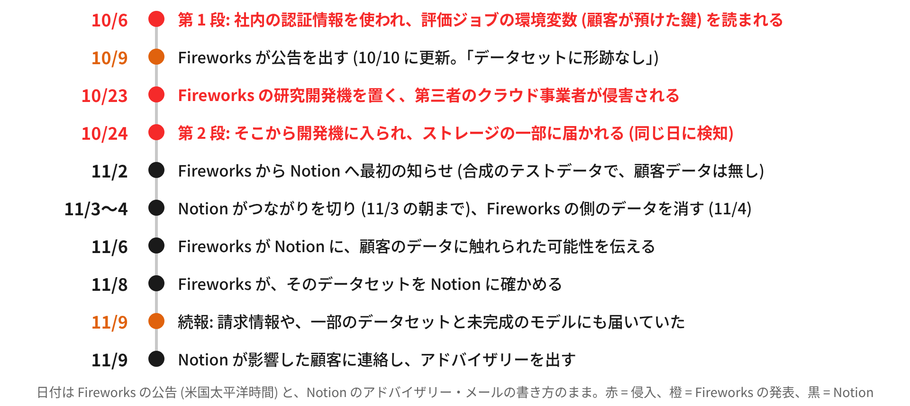
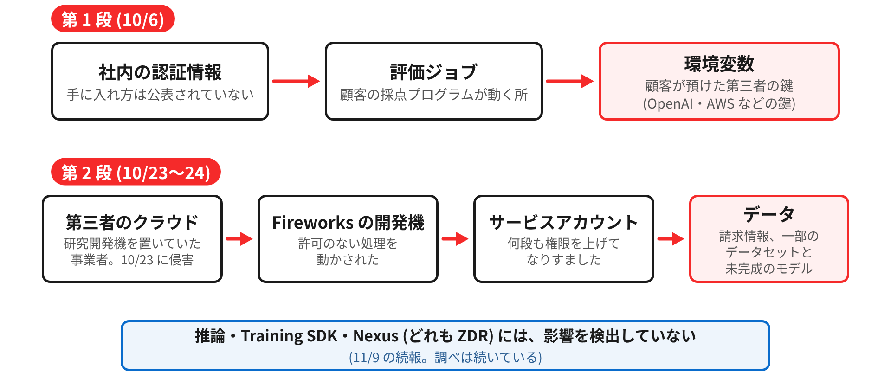
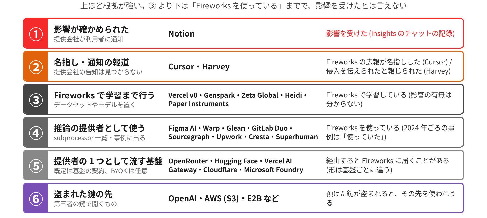
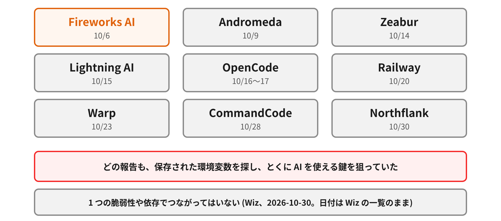

## はじめに

個人で Notion の Business プランを契約して、Notion AI を使っている。そのワークスペースに、Notion から「取引先の Fireworks AI で起きたセキュリティインシデントで、影響を受けたかもしれない」というメールが届いていた。自分にも影響がありそうだったので、Fireworks で何が起き、ほかにどこへ影響していそうかを調べてみることにした。

この記事では、Fireworks の事件の全体 (2 回の侵入、評価ジョブと鍵、ほかの影響先、同じ月に続いた事件) を、自分用のメモも兼ねてざっくりまとめる。同じ話を、約 24 分の解説動画にもした。

https://www.youtube.com/watch?v=HhDDv4BwL5Y

漏れた記録に何が入っていたのか、利用者は何を確かめればよいのかといった、Notion AI の利用者の側から見た話は、[もう 1 本の記事](https://zenn.dev/pollenjp/articles/2026-11-14-notion-ai-fireworks-incident)に分けた。

:::message
2026-11-14 (日本時間) 時点の情報。Fireworks も Notion もまだ調べている途中で、発表を出した後にも更新しているので、細かいところは変わるかも。ほかの会社の subprocessor 一覧や事例は、2026-11-10 に読んだもの。
:::

## TL;DR

- 侵入は 2 回。10/6 に評価ジョブの環境変数 (顧客が預けた第三者の鍵) を読まれ、10/23〜24 には第三者のクラウド経由で開発機に入られ、顧客データの一部に届かれた
- 評価ジョブに預けていた第三者の鍵は、公告のとおり発行元で作り直す (預け先で消すだけでは無効にならない)
- 10/10 の公告は「データセットにアクセスされた形跡は見つかっていない」、11/9 の続報は「一部にアクセスされた」。限定の言葉まで読む必要がある
- 影響が確かめられたのは、11/14 の時点で Notion だけ。ほかは根拠の強さで 6 つの層に分けて読む
- 同じ 10 月、AI の開発基盤で事件の公表が続き、どれも保存された環境変数を狙っていた (Wiz のまとめ)

## 推論基盤とは

Notion AI のようなアプリの中の AI 機能は、全部のモデルをアプリの会社が動かしているとは限らない。自社のモデルを API で貸す OpenAI や Anthropic のほかに、公開されたモデル (open-weight) を GPU で動かして貸す推論基盤がいて、Fireworks はその 1 つ。モデルを手直しする学習の場も貸している。

Notion の subprocessor 一覧 (Notion がデータを扱わせている外の会社の一覧) にも、Fireworks は「LLM を配信し、AI の機能を動かす計算基盤」として載っていた。この行は、11/12 の更新で消えている。

もう 1 つよく出てくるのが、ZDR (zero data retention。応答した後に、送った文も応答も残さないこと)。Fireworks の ZDR は推論の話で、docs 自身が、バッチのジョブや学習などは顧客の中身を保存すると書いている。この違いが、後で Notion の件に効いてくる。

## 2 回の侵入

侵入と発表を時系列で並べると、こうなる。

第 1 段 (10/6) では、社内の認証情報が許可なく使われ、限られた数の顧客アカウントで、評価ジョブに渡す環境変数が読まれた。そこには、顧客が預けた、ほかのサービスの API キーやトークンが入っていた。

第 2 段 (10/23〜24) では、研究開発用のマシンを置いていた第三者のクラウド事業者が侵害され、そこから開発機に入られた (11/9 の続報)。CEO の記事によると、何段も権限を上げてサービスアカウントの 1 つになりすまし、ストレージの一部に届いたとのこと。届いたのは、請求の情報や、一部の顧客のデータセットと未完成のモデルの重みなど。

続報は、実行者を、盗んだ LLM の利用枠を裏で売る金銭目的の集団 (LLMJacking) とつなげている。請求は鍵の持ち主に行く、という手口らしい。

公告の言い方も変わった。10/10 版は、顧客のデータセットなどに「許可なくアクセスされた形跡は見つかっていない」と書き、11/9 の続報は「一部のデータセットにアクセスされた」と書いている。10/10 版には「現時点の調べでは」などの限定が付いていて、第 2 段は 10/10 より後の出来事。それでも「形跡なし」と読んだ人には、向きが変わったことになる。

## 評価ジョブと鍵

第 1 段で読まれた評価ジョブは、強化学習のファインチューニング (RFT) で、モデルの答えを採点するプログラム (evaluator) を動かすジョブ。採点で別の LLM やストレージを使うための鍵を、顧客は secret として Fireworks に預け、Fireworks はそれを環境変数として evaluator に渡していた。読まれたのは、この環境変数。

Fireworks は、10/6 の検知より前の 10/1 に managed RFT の新しいジョブの受付を止めていて、11/10 に読んだ docs では、evaluator と評価ジョブも削除したと書いていた。いつ削除したかは書かれていない。

10/10 版の公告は、通知にある第三者の鍵を、預け先の secret を消すだけでなく発行元で作り直し、その鍵で読み書きできるデータの記録 (ログ) も見るよう勧めている。

## Notion への影響

11/14 の時点で、提供会社が自分で利用者に通知したと確かめられたのは Notion だけ。漏れたのは、Notion が Insights (チームの AI の使い方を見る機能) の分析のために Fireworks へ送っていたチャットの記録だった。

推論はその場で応答して終わるが、分類のジョブは記録を Fireworks の側に置いてから処理する。ZDR が守るのは前者で、第 2 段の侵入は後者の置き場に届いた。ただ Notion は、この分析についても Fireworks が ZDR を契約で約束していたのに、データが残っていた、と書いている。Fireworks がこの点に公に答えたものは、11/14 までに見た範囲では見つからなかった。

漏れた記録の中身や利用者が確かめることは、ZDR の件への自分の感想も含めて、もう 1 本の記事に書いた。

## ほかの影響先は 6 つの層で読む

Fireworks を使っているサービスは、ほかにもたくさんある。ただ、「使っている」と「影響を受けた」は違うので、根拠の強さで 6 つの層に分けて並べた。

- ① 影響が確かめられた: 提供会社が利用者に通知した Notion だけ (11/14 の時点)
- ② 名指し・通知の報道: Cursor と Harvey。Fireworks の広報が Cursor などと対応を進めていると述べた (Bloomberg Law)、Fireworks が Harvey などの大口の顧客に深刻な侵入を伝えた (The Information)、という報道まで。提供会社の告知は、11/13 に探し直しても見つからなかった
- ③ Fireworks で学習まで行う: Vercel v0・Genspark など。データセットやモデルを Fireworks に置くことがあるが、影響の有無は分からない
- ④ 推論の提供者として使う: Figma・Warp・Glean などが subprocessor 一覧に載せていて、GitLab Duo のコード補完の既定のモデルも Fireworks で動いていた (11/10 に読んだ資料での話)
- ⑤ 提供者の 1 つとして流す基盤: OpenRouter など (11/10 の時点)。基盤の契約で呼ぶ既定と、自分の鍵を渡す BYOK とで話が変わる
- ⑥ 盗まれた鍵の先: 評価ジョブに預けた第三者の鍵で開くサービス。影響は、Fireworks の顧客でない側に出る

③ より下は「Fireworks を使っている (いた)」までで、影響を受けたとは言えない。Fireworks は、影響を特定した顧客には直接知らせた、と書いている。

## 同じ月に続いた事件

Wiz は 10/30 の記事で、10 月に少なくとも 9 つの AI 開発基盤が事件を公表したとまとめ、「Black October」と呼んでいる。

どの報告も、保存された環境変数、とくに AI を使える鍵を探し回っていた。一方で入口はまちまちで、Wiz も、これらを結び付ける単一の脆弱性や依存は無いと書いている。Warp も 10 月に自社の別の事件を公表しているが、Fireworks の件と結び付ける資料は見つからなかった。

前にも似た形の事件はあった。CircleCI (2023 年 1 月の公表) や Codecov (2021 年) では、顧客の環境変数や鍵を預かる所が破られ、預けた鍵を全部作り直すよう求められた。たくさんの鍵を預かる所が破られると、被害はその鍵の先へ広がり、預かっていた側からはその先が見えない。Fireworks の第 1 段も、同じ形をしている。

## おわりに

調べてみると、同じ Fireworks の顧客でも、どの機能に何を預けていたかで、話がかなり違う事件だった。推論は ZDR で無事でも、ジョブのために置いたデータや、評価ジョブに預けた鍵は、その外にあった。

推論基盤に鍵を預けているなら、どの鍵をどこに預けているかと、預け先の ZDR がどの機能まで覆うのかを一度見ておくとよいでしょう。11/14 の時点で調べは続いているので、新しく分かったことは日付を付けて追記していく。

参考になれば幸い。もし誤っているところがありましたらごめんなさい。コメントで教えてもらえると助かります。

## もう 1 本の記事

Notion AI の利用者の側から見た話は、もう 1 本の記事にまとめた。ZDR の 2 つの約束と記録が残っていたわけ、漏れた記録に何が入っていたか (AI が読んだページは入ったのか)、貼られていた鍵で何に届くか、「1% 未満」の読み方と、利用者が確かめることまで。

https://zenn.dev/pollenjp/articles/2026-11-14-notion-ai-fireworks-incident

こちらも、約 38 分の解説動画にした。

https://www.youtube.com/watch?v=mKMe5LazasA

## 参考

- [Fireworks の公告: October 2026 security incident](https://fireworks.ai/security/bulletins/october-2026-security-incident) (2026-10-10 11:16 PDT 版)
- [Fireworks の続報: Update on October 2026 security incident](https://fireworks.ai/security/bulletins/october-2026-security-incident-update) (2026-11-09)
- [Fireworks の CEO の記事: October Incident Update](https://x.com/lqiao/status/2119943330612256890) (X、2026-11-10)
- [Fireworks docs: Zero Data Retention](https://docs.fireworks.ai/accounts/zero-data-retention)
- [Notion のセキュリティアドバイザリー: Fireworks AI incident](https://www.notion.com/security/advisories/security-incident-involving-a-third-party-ai-vendor) (11/12 の版と Updates)
- [Bloomberg Law](https://news.bloomberglaw.com/artificial-intelligence/nvidia-backed-fireworks-ai-discloses-its-second-hack-in-weeks) (2026-11-09)
- [Wiz: "Black October" for AI Developer Platforms](https://www.wiz.io/blog/black-october-for-ai-developer-platforms) (2026-10-30)
- [GTIG・Mandiant: The Rise of LLMJacking](https://cloud.google.com/blog/topics/threat-intelligence/llmjacking-monetizing-compromised-cloud-models) (2026-11-02)
