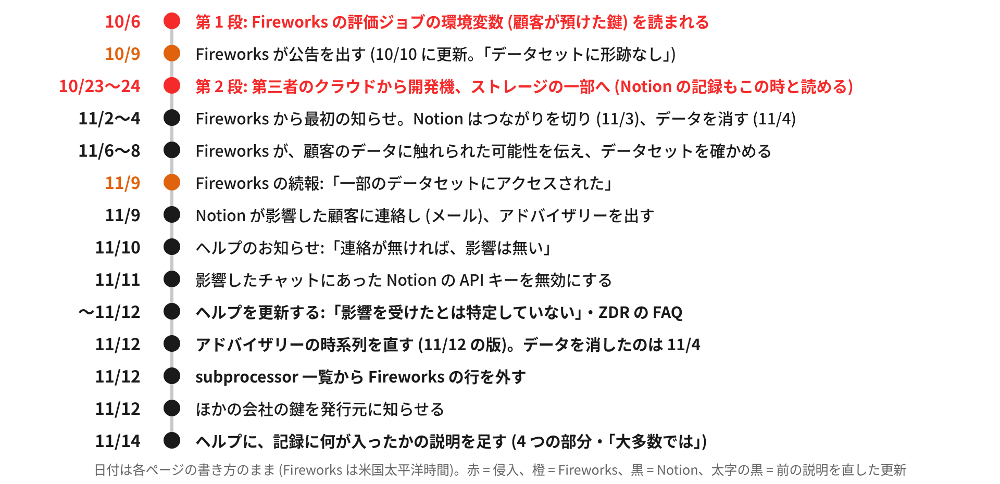
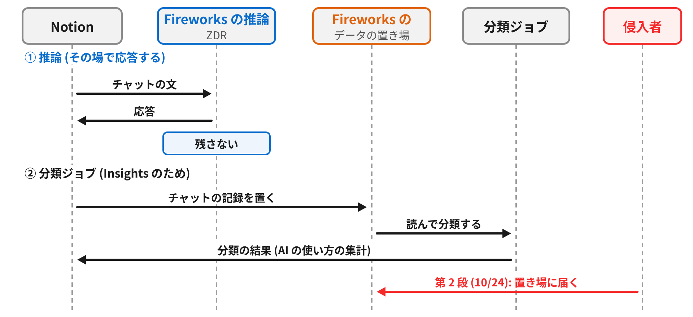
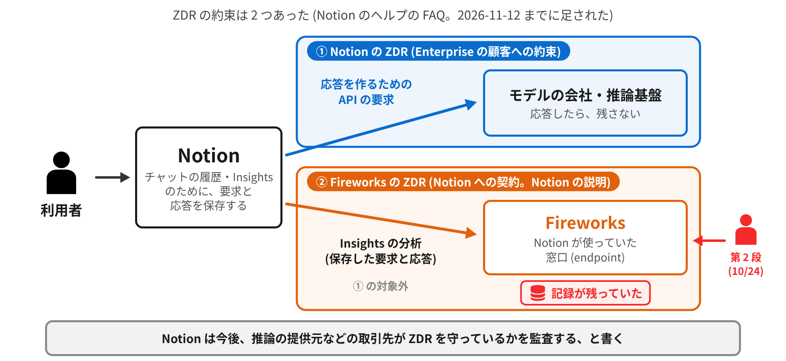
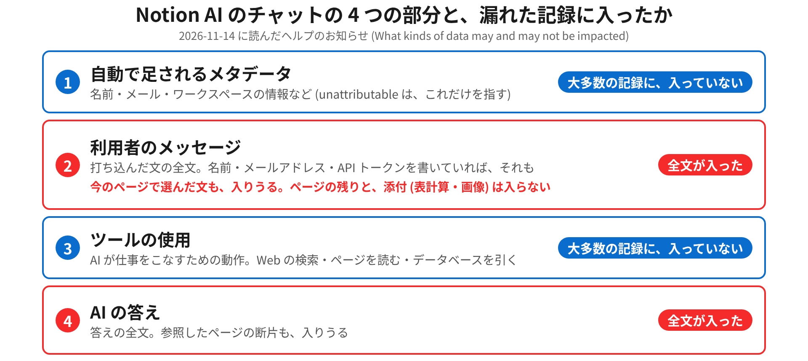
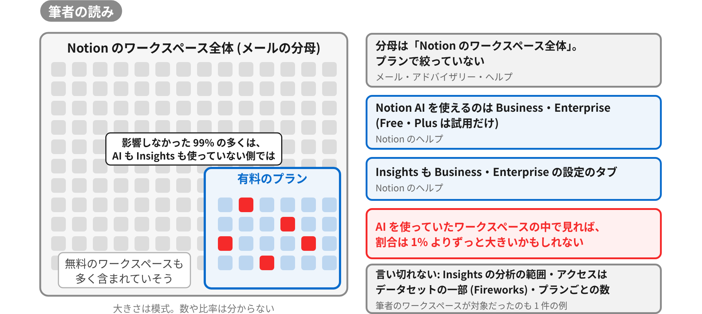

## はじめに

個人で Notion の Business プランを契約して、Notion AI を使っている。そのワークスペースに、Notion から「取引先の Fireworks AI で起きたセキュリティインシデントで、影響を受けたかもしれない」というメールが届いていた。自分にも影響がありそうだったので、何が起きたのかを調べてみることにした。

この記事では、Notion AI の利用者の側から、漏れた記録に何が入っていたのか、利用者は何を確かめればよいのかを、自分用のメモも兼ねてざっくりまとめる。同じ話を、約 38 分の解説動画にもした。

https://www.youtube.com/watch?v=mKMe5LazasA

2 回の侵入の流れや盗まれた鍵、Notion のほかにどこへ影響していそうかといった Fireworks の事件の全体は、[もう 1 本の記事](https://zenn.dev/pollenjp/articles/2026-11-10-fireworks-ai-incident)に分けた。

:::message
2026-11-14 (日本時間) 時点の情報。Notion も Fireworks もまだ調べている途中で、発表を出した後にも何度か更新しているので、細かいところは変わるかも。
:::

## TL;DR

- 漏れたのは、Insights (チームの AI の使い方を見る機能) の分析のために Fireworks に送っていたチャットの記録。ZDR (データを残さない) の推論は無事でも、ジョブのために置いたデータはその外だった
- Notion によると、Fireworks は ZDR を契約で約束していたが、記録は残っていた
- **unattributable (誰のものか結び付けられない) は「漏れていない」ではない**。メッセージと AI の答えは全文が入り、貼られた API キーも見つかった
- 「1% 未満」の分母は Notion のワークスペース全体。AI を使っていた側の中では、割合はもっと大きいかもしれない (自分の読み)
- 連絡が来たら、影響したデータを取り出して鍵を探し、発行元で作り直す

## 推論は無事なのに、チャットが漏れた

Fireworks は、公開されたモデル (open-weight) を GPU で動かして API で貸す推論基盤。Notion の subprocessor 一覧 (Notion がデータを扱わせている外の会社の一覧) にも載っていたが、11/12 の更新でこの行は消えた。

その Fireworks に、10 月に 2 回の侵入 (第 1 段・第 2 段) があった。11/9 の続報によると、第 2 段 (10/23〜24) では一部の顧客のデータセットにアクセスされた一方で、ZDR の推論には影響を検出していないらしい。侵入から、Notion の連絡と発表の更新までを並べると、こうなる。

それでもチャットが漏れたわけは、Notion のメールにある使い方を見ると分かる。Notion は Fireworks を、推論のほかに、Insights のための分類ジョブにも使っていた。漏れたのは、この分類ジョブの側の記録。

推論はその場で応答して終わるが、分類ジョブはチャットの記録をまとめて Fireworks の置き場に置いてから処理する。つまり ZDR が守るのは前者で、ジョブのために置いたデータまでは覆わない。「推論は無事」と「チャットが漏れた」は、矛盾せずに両立する。

## ZDR を約束していたのに、記録は残っていた

Notion のヘルプのお知らせの FAQ によると、この分析についても、Fireworks は Notion に ZDR を契約で約束していた (contractual commitment to zero data retention)。それなのに調べてみると、Notion が使っていた Fireworks の窓口 (endpoint) にデータが残っていたとのこと。

ZDR の約束は 2 つある。Notion が Enterprise の顧客にする ZDR は応答を作るための要求だけが対象で、Insights のように保存して使う機能は外。もう 1 つが Fireworks が Notion にした契約の ZDR で、こちらは Notion の使い方を覆っていた、というのが Notion の説明。

一方の Fireworks は、推論などは「既定で ZDR」と書き、docs では Batch API のようにデータを保存するサービスを ZDR の外としている。Notion の説明に Fireworks が公に答えたものは、11/14 までに見た範囲では見つからなかった。どの機能が記録を置いていたのかも、どちらの会社も書いていない。

ここからは自分の感想。データを残さないと契約で約束していたのに、記録は残っていた。Notion の説明のとおりだとすると、ちょっとどうなんでしょうね……と思ってしまう。ただ、契約が何をどこまで約束していたのかは分からないので、「Fireworks が契約を破った」とまでは言えない。

## 漏れた記録に入っていたもの

Notion のメールは、漏れた記録を unattributable と呼び、「誰が書いたかやどのワークスペースから来たかのラベルが無く、ツールの呼び出し結果も含まれていない」という意味だと説明している。ツールの呼び出し結果は、AI がページを読んだり検索したりして受け取った結果のこと。

AI に読ませたページの中身が入ったかは、11/14 に読んだヘルプのお知らせが、チャットを 4 つの部分に分けて書いていた。

AI が読んだだけで答えに出さなかったページの中身は、入っていない。ただ、AI の答えは全文が入るので、答えに引いたページの文は残る。自分でメッセージに貼った文も入る。それに、入っていないと言えるのは「影響した記録の大多数では」の話で、残りに何が入っていたかは書かれていない。

ラベルが無くても本文は残るので、チャットに人や会社の名前を書いていれば、そこから結び付けられる。unattributable は「漏れていない」という意味ではなく、メールも、漏れたものとして扱うよう勧めている。

## 貼られていた鍵

本文が残ることは、実際に効いていた。Notion は 11/11 に、影響した利用者のメッセージから見つかった Notion の API キーを無効にし、11/12 にはほかの会社の鍵を発行元に知らせている。見つかったのは利用者がチャットに貼った鍵で、Notion の AI が中で使う鍵の話ではない。

Notion の鍵は種類で届く範囲が違い、個人アクセストークン (PAT) なら、作った人が見られるもの全部に届く。見つかった鍵がどの種類だったかは書かれていない。

侵入者が記録に届いたのが第 2 段 (10/24) だとすると、無効にされた 11/11 までのおよそ 2 週間半、鍵は使える状態だったことになる (自分の読み)。鍵はそれだけで使えるので、ここでは unattributable は守りにならない。その間に使われたかは、書かれていない。

## 「1% 未満」は何の 1% か

メール・アドバイザリー・ヘルプは、影響したワークスペースを「Notion のワークスペースの 1% 未満」と書いている。分母は Notion のワークスペース全体で、利用者の数でもチャットの数でもない。

ここからは自分の読みと感想。Notion AI を使えるのは Business と Enterprise (Free と Plus は試用だけ) で、Insights も Business か Enterprise の設定のタブ。分母には AI を使えない無料のワークスペースも多く入っていそうで、影響しなかった 99% 余りの多くは、そもそも Notion AI も Insights も使っていない側なのかもしれない。そうなら、AI を使っていた側の中で見た割合は、1% よりずっと大きい。

ただ、プランごとの数は公表されておらず、確かめようがない。自分のワークスペースが対象だったのも、1 件の例にすぎない。それでも AI を使っていた側から見ると、「1% 未満」は影響を小さく見せる言い方にも聞こえて、ちょっと引っかかる。とはいえ分母はどの文書にも書いてあって、数え方そのものは誤りではない。

## 連絡が来たら、来ていなければ

連絡が来たワークスペースでは、オーナーと影響したメンバーが、サイドバー → `?` → `Security incident review` から影響したデータを取り出せる (11/14 に読んだヘルプの形)。

- まず鍵を探す。ドメインを確かめた Business と Enterprise のオーナーが取り出せる注釈つきの CSV で、`__analysis_secret_categories` が `[]` でない行を絞る
- 見つけたら発行元で作り直す。チャットから消しても、漏れた写しは消えない
- チャットにあった名前やメールアドレスを使ったフィッシングにも気を付ける

連絡が来ていなければ、ヘルプとアドバイザリーは「影響を受けたとは特定していない。調べは続いていて、分かれば直接連絡する」と書いている (11/10 のヘルプは「影響は無い」と言い切っていた)。連絡はオーナーに届くので、メンバーはオーナーに確かめるのが早い。

## おわりに

調べてみると、ZDR は誰のどの機能についての約束かで覆う範囲が違い、unattributable はラベルが無いだけで本文は残っていた。Notion の発表も、「前に伝えた事実は変えていない」と書いた版の 2 日後に、データを消した日が 11/3 から 11/4 に直るなど、何度も更新されている。

Notion AI を使っているなら、チャットに鍵やパスワードを貼っていないかを一度見ておくとよいでしょう。11/14 の時点で調べは続いているので、新しく分かったことは日付を付けて追記していく。

参考になれば幸い。もし誤っているところがありましたらごめんなさい。コメントで教えてもらえると助かります。

## もう 1 本の記事

Fireworks の事件の全体は、もう 1 本の記事にまとめた。2 回の侵入の流れと公告の言い方の変化、評価ジョブと盗まれた鍵の扱い、Notion のほかにどこへ影響していそうか (根拠の強さで 6 つの層に分ける)、同じ月に続いた事件まで。

https://zenn.dev/pollenjp/articles/2026-11-10-fireworks-ai-incident

こちらも、約 24 分の解説動画にした。

https://www.youtube.com/watch?v=HhDDv4BwL5Y

## 参考

- 筆者に届いた Notion のメール (Fireworks AI のインシデントのお知らせ)
- [Notion のセキュリティアドバイザリー: Fireworks AI incident](https://www.notion.com/security/advisories/security-incident-involving-a-third-party-ai-vendor) (11/12 の版と Updates)
- [Notion のヘルプのお知らせ](https://www.notion.com/help/security-incident-involving-a-third-party-ai-vendor) (2026-11-14 に読んだ形)
- [Notion's List of Subprocessors](https://notion.notion.site/Notion-s-List-of-Subprocessors-268fa5bcfa0f46b6bc29436b21676734)
- Notion の開発者向け docs: [Authorization](https://developers.notion.com/guides/authorization/overview)・[Personal access tokens](https://developers.notion.com/guides/connections-and-tokens/personal-access-tokens)
- [Fireworks: Update on October 2026 security incident](https://fireworks.ai/security/bulletins/october-2026-security-incident-update) (2026-11-09)
- [Fireworks docs: Data Security](https://docs.fireworks.ai/guides/security_compliance/data_security)
